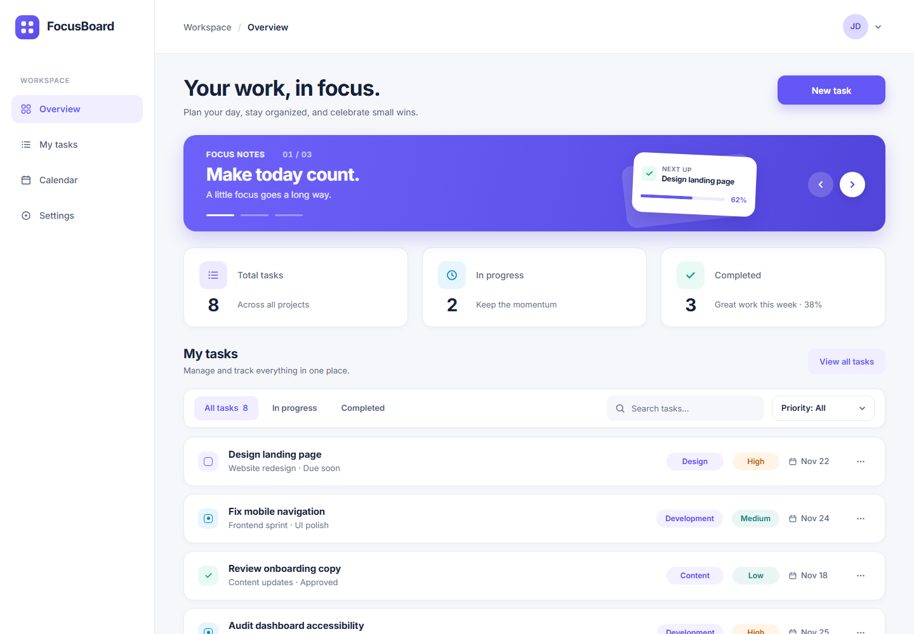
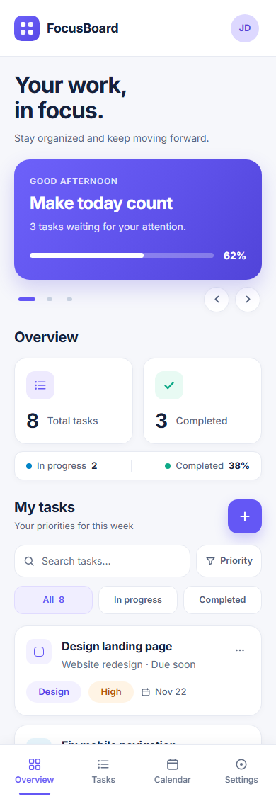

# FocusBoard — Responsive Task Management Dashboard

FocusBoard is a responsive, frontend-only task management dashboard built with React and Vite for a Frontend Trainee Assessment. It brings task organization, live progress tracking, combined search and filtering, a Focus Notes carousel, and dedicated desktop, tablet, and mobile layouts together in a single-user workspace.

## Features

- Create, edit, and delete tasks, with an explicit confirmation dialog before destructive deletion.
- Manage tasks across three statuses: **To do**, **In progress**, and **Completed**.
- Filter tasks with case-insensitive title search, status tabs, and priority filtering working together.
- View dynamically calculated task statistics (`Total tasks`, `In progress`, `Completed`, and completion percentage).
- Navigate a three-slide **Focus Notes** carousel with slide controls and active indicators.
- Persist task updates locally in browser `localStorage` across page reloads.
- Validate required task form inputs (`Task title` and `Due date`) with clear inline error feedback.
- Use responsive layouts designed for desktop (`1440 × 1000`), tablet (`768 × 900`), and mobile (`390 × 1128`).

## Technology Stack

- **React 19** (`react`, `react-dom`)
- **JavaScript (ES6+) and JSX**
- **Vite 6** (`vite`, `@vitejs/plugin-react`)
- **Custom CSS3** with CSS custom properties
- **React Context API and `useReducer`**
- **Browser `localStorage`**
- **Reusable inline SVG icons**

FocusBoard is strictly a frontend-only application with no Express server, backend API, authentication service, or cloud database.

## Getting Started

### Prerequisites

- **Node.js** (v18 or later recommended) and **npm** — required only to run Vite and npm tooling scripts locally (the app does not use a Node.js backend).

### Installation & Local Development

```bash
git clone <YOUR_PUBLIC_GITHUB_REPOSITORY_URL>
cd focusboard
npm install
npm run dev
```

Open the local URL displayed by Vite (typically `http://localhost:5173`).

### Production Build & Preview

```bash
npm run build
npm run preview
```

> **Windows PowerShell note:** If PowerShell execution policies block `npm.ps1`, run `npm.cmd install`, `npm.cmd run dev`, `npm.cmd run build`, and `npm.cmd run preview`.

## Project Structure

```text
focusboard/
├── index.html
├── package.json
├── vite.config.js
├── README.md
├── AI_USAGE.md
└── src/
    ├── App.jsx
    ├── main.jsx
    ├── components/
    ├── data/
    ├── hooks/
    ├── state/
    ├── styles/
    └── utils/
```

## Implementation Highlights

- **Shared State (`Context + useReducer`):** Centralizes task CRUD, status changes, filters, and carousel state in a single immutable source of truth without external state libraries.
- **Derived Statistics & Combined Filtering:** Computes overview totals, completion percentage, and filtered task lists dynamically from current state using strict AND logic across search, status, and priority.
- **Safe `localStorage` Persistence:** Saves task changes under `focusboard_tasks_v1`, seeds eight sample tasks only when no valid saved data exists, preserves an intentionally empty task list (`[]`), and falls back cleanly on corrupted storage.
- **Responsive & Accessible UI:** Adapts navigation, statistics, priority filtering, and carousel controls across desktop, tablet, and mobile viewports with semantic landmarks, accessible labels, keyboard support, and modal focus management. (`Calendar`, `Settings`, and the `JD` avatar menu remain lightweight visual placeholders per assessment scope.)

## Screenshots

### Desktop Preview



### Mobile Preview



## Links

- **Live Application:** `<YOUR_HTTPS_DEPLOYMENT_URL>`
- **GitHub Repository:** `<YOUR_PUBLIC_GITHUB_REPOSITORY_URL>`

## AI Usage

This project was developed using an AI-assisted, prompt-driven workflow with iterative human review and browser testing. See [AI_USAGE.md](AI_USAGE.md) for the complete disclosure of AI tools used, development workflow, representative prompts, and examples of suggestions checked, corrected, or rejected.
